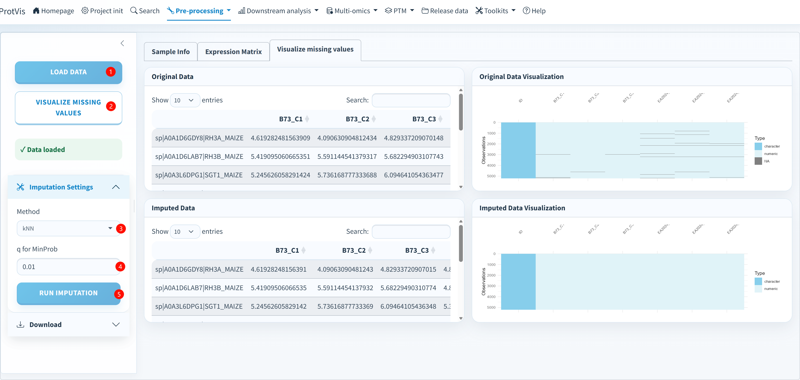

## Why imputation is explicit

Proteomics missingness may reflect abundance limits, identification uncertainty, stochastic sampling or technical failure. Missing values can remain `NA` until this stage when upstream group-mean filling is disabled; the Existing method can already fill some entries.

At load time the module converts non-finite values to missing and treats `0`/`-8` sentinels as not observed in the compatibility workflow. Rows/columns that are entirely missing are removed from the matrix passed to the imputation engine.

## Current methods

| Method | Notes |
|---|---|
| **kNN (MaxQuant recommended)** | `impute::impute.knn`; current GUI default |
| **RF** | `missForest::missForest` |
| **Mean** | column-mean replacement |
| **Median** | column-median replacement |
| **Minimum** | column-minimum replacement |

**Zero** and the old **q for MinProb** control are no longer part of the current UI.

## Random seed

The current interface exposes **Random seed**, default:

```text
12345
```

ProtVis calls `set.seed()` before imputation. Preserve this value in Methods when exact reproduction matters.

## GUI workflow

{#fig-data-imputation-gui fig-alt="ProtVis Data Imputation screenshot showing load, missingness visualization, method selection and input/output panels. Current interface now has Random seed and no q-for-MinProb control." width="100%" fig-align="center"}

1. **Load data** from the active Step4/project state.
2. **Visualize missing values** before filling anything.
3. Select the method and confirm the random seed.
4. Click **Run imputation**.
5. Compare original versus imputed tables/visualizations.

ProtVis warns when rows contain more than 50% missing values because similarity-based kNN estimates can become unstable.

::: {.callout-important}
## Recommended DEP does not use Step5 imputed values
Imputation is still useful for heatmaps, complete-matrix QC, normalization and other methods that require complete data. The default **Recommended DEP** inferential workflow instead uses Step4 intensities and a detection filter (Step4 can include earlier within-group filling) to avoid turning imputed values into artificial statistical evidence.
:::

## Output

The imputed matrix is appended as a schema-v4 preprocessing run and persisted for compatibility as:

```text
Step5_data_imputation.rda
```

Continue with [Data normalization](data_normalization.qmd).

## Method selection in practice

| GUI method | Actual implementation | Appropriate exploratory scenario | Important limitation |
|---|---|---|---|
| kNN | `impute::impute.knn` on proteins × samples | Scattered missing values with informative neighboring protein profiles | Not a group-aware or low-abundance censoring model |
| RF | `missForest::missForest` on the protein-row/sample-column table | Nonlinear relationships among samples, enough observed data | More computation; does not explicitly use group labels |
| Mean | Replace NA with the mean of the same **sample column** | Simple baseline comparison | Different from within-group protein mean; compresses variation |
| Median | Replace NA with the median of the same **sample column** | Robust simple baseline | Creates repeated values and can distort distributions |
| Minimum | Replace NA with the minimum of the same **sample column** | Exploratory low-value sensitivity comparison | A single observed minimum is not a fitted detection-limit model |

Mean/Median/Minimum pool proteins within a sample column. They do **not** estimate each protein's missing value from its biological replicates. The separate Within-group Processing checkbox does that instead.

Missingness scattered across samples and consistent with a MAR mechanism can motivate neighborhood-based methods. Systematic absence of low-abundance proteins may be MNAR; simple mean filling can overestimate such intensities. A pattern alone does not prove the mechanism. ProtVis does not currently expose QRILC or MinProb in this GUI; these are external alternatives discussed in the [DEP missing-value guidance](https://bioconductor.org/packages/release/bioc/vignettes/DEP/inst/doc/MissingValues.html), not implemented selector options.

## Step-by-step use

1. **Load data** after transformation and confirm the incoming scale and sample IDs.
2. **Visualize missing values**; distinguish scattered missingness from entire missing groups or poor samples.
3. Select a method. The GUI starts with kNN; this is an interface default, not a universal recommendation.
4. Set **Random seed** (default 12345), then **Run imputation**.
5. Compare original and imputed matrices/distributions; inspect whether observed values stayed unchanged.
6. Use the module's export/save action to commit the result to `ProtVis_dataset` and create Step5. **Processing report** is generated for that saved run.
7. Inspect missing values remaining, filled counts per sample and shifts in sample medians before continuing.

The engine input removes entirely missing rows/columns, so a filled matrix need not have the same dimensions as the original input. This removal should not be mistaken for successful recovery of entirely absent proteins. High missingness can trigger a kNN warning.

The GUI calls kNN without overriding its engine arguments. The [impute manual](https://bioconductor.org/packages/release/bioc/manuals/impute/man/impute.pdf) documents defaults including `k=10`, `rowmax=0.5`, `colmax=0.8` and an internal `rng.seed`. Thus recording the GUI seed alone does not imply that all kNN random behavior uses that seed; record the package version and call as well.

## Downstream decisions

Use imputed matrices for methods explicitly requiring complete inputs, such as selected visualizations. For differential inference, confirm the actual DEP input and preserve observed/detection evidence. Do not use “missingness became zero” as the sole quality criterion. Compare key findings under reasonable alternate methods and report method-sensitive proteins separately.

[Implementation](https://github.com/anhuikylin/ProtVis/blob/dev/R/data_imputation.R).
