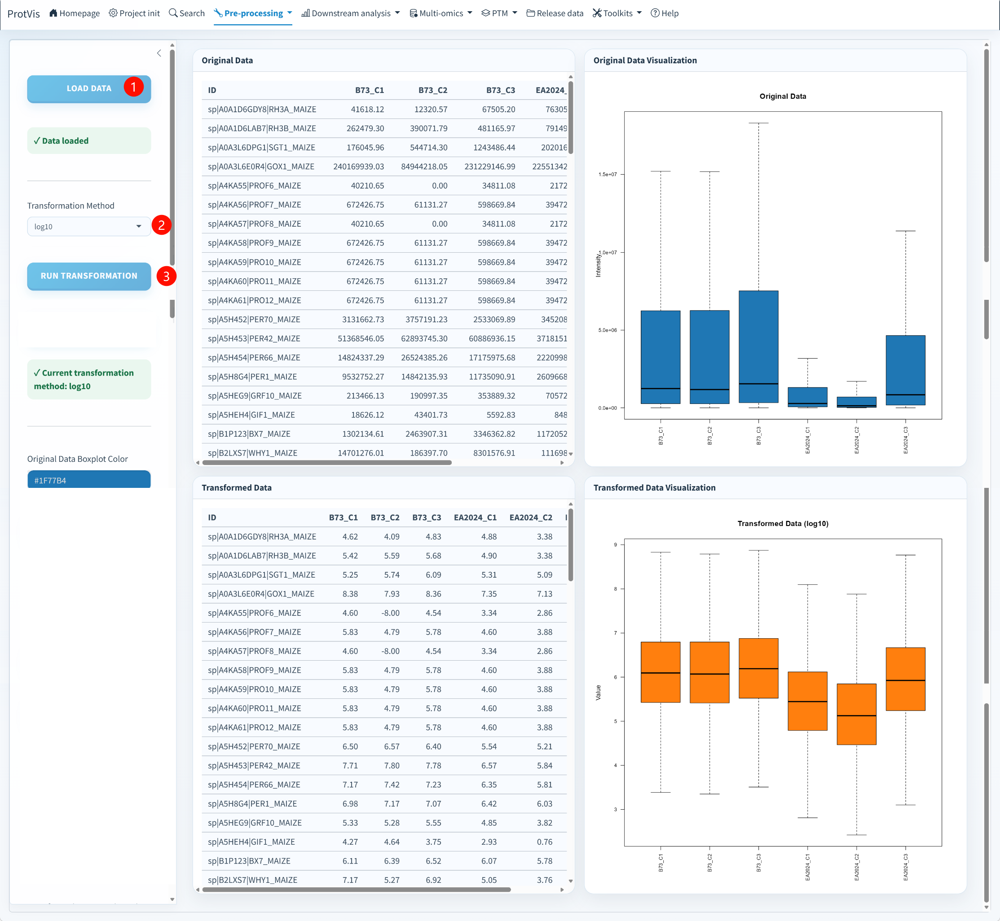

## Current methods

The current transformation selector is grouped into:

**Recommended**

- **Auto (source recommended)**
- **MaxQuant: log2(x × 1e7)**
- **log2**
- **None**
- **log10**

**Advanced**

- **Z-Score**
- **Scale only**
- **Center only**
- **Scale + center**

For MaxQuant, Auto reproduces the archived preprocessing transform `log2(intensity × 1e7)` and requires positive observed intensities. For other sources, Auto resolves to the source-specific preset.

## GUI workflow

{#fig-data-transformation-gui fig-alt="ProtVis Data Transformation page with Load data, transformation selection, Run transformation, input/output tables and boxplots." width="100%" fig-align="center"}

1. Click **Load data** and verify the protein/sample matrix.
2. Select **Auto** or an explicit method.
3. Click **Run transformation**.
4. Compare original and transformed distributions.
5. Export the diagnostic PDFs when they are part of the analysis record.

The screenshot predates the newer source-aware Auto/MaxQuant choices, so use the **current control labels in the running app** rather than copying the screenshot's selected method.

## Choosing the scale

Do not apply log2/log10 to values that are already logarithmic. Advanced scaling methods are useful for pattern visualization but change the quantitative interpretation and may be inappropriate before abundance-based differential models.

## Output and downstream role

The transformed state is recorded in schema v4 and written to the compatibility snapshot:

```text
Step4_data_transformed.rda
```

Step4 is especially important because **Recommended DEP uses the observed transformed matrix before imputation**. Preserve missing values here rather than replacing them merely to make the matrix visually complete.

Continue with [Data imputation](data_imputation.qmd) for analyses requiring a complete matrix, or later use Step4 directly through Recommended DEP.

## Exact transformations and use cases

The current GUI uses **log2 transformation** for its source-aware `auto` choice. For MaxQuant this resolves to `log2(x × 10^7)`; for other sources it resolves to direct log2. Check the resolved method rather than assuming Auto means the same formula for every data source.

| Choice | Actual operation | Suitable use | Interpretation |
|---|---|---|---|
| Scaled log2 / MaxQuant preset | `log2(x × 10^7)` on positive observed values | Archived MaxQuant reproduction | Adds approximately 23.2535 to direct log2; it is not sample normalization |
| Direct log2 | `log2(x + 10^-8)` | Positive intensities with a wide dynamic range | A difference of 1 corresponds approximately to a twofold ratio |
| log10 | `log10(x + 10^-8)` | Display on a decimal logarithmic scale | Difference of 1 corresponds approximately to tenfold intensity |
| None | Preserve values | Already transformed input or an intentionally raw workflow | Downstream analysis must accept this scale |
| Z-score / Scale + center | R `scale(x, center=TRUE, scale=TRUE)` | Pattern comparison or exploratory displays | Centers and scales each sample column, not each protein row |
| Scale only | R `scale(x, center=FALSE, scale=TRUE)` | Explicit uncentered column scaling | R uses an uncentered root-mean-square divisor, not simply the column SD |
| Center only | R `scale(x, center=TRUE, scale=FALSE)` | Exploratory column mean centering | Subtracts each sample column mean |

Never log an already log-transformed matrix. Z-score/centering outputs can contain negative values; do not subsequently treat those as raw undetected intensities. Constant or sparsely observed columns can yield non-finite scaled values. Review the report and resolve those columns before downstream analysis.

## Worked example and reporting

For raw values 100 and 200, direct log2 produces approximately 6.644 and 7.644. The scaled MaxQuant formula produces approximately 29.897 and 30.897. Both preserve the one-unit difference in this example, but their absolute scales differ.

After **Run transformation**, open **Processing report**. It contains matrix dimensions, finite-value count, missing/non-finite percentage, median and range, plus sample-level changes. A transformation normally changes observed values rather than filling missing entries. New non-finite values require investigation; a compressed range is an expected scale effect, not evidence that biological variability improved.

Describe results using the actual numbers, for example: “After direct log2 transformation, the matrix contained X proteins and Y samples; missingness was Z%, and finite values ranged from A to B with median M.” Record the resolved method, input scale and relevant multiplier/pseudocount.

[Implementation](https://github.com/anhuikylin/ProtVis/blob/dev/R/data_transformed.R).
